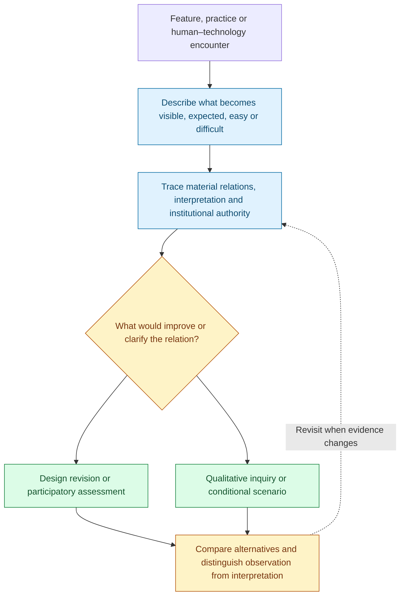
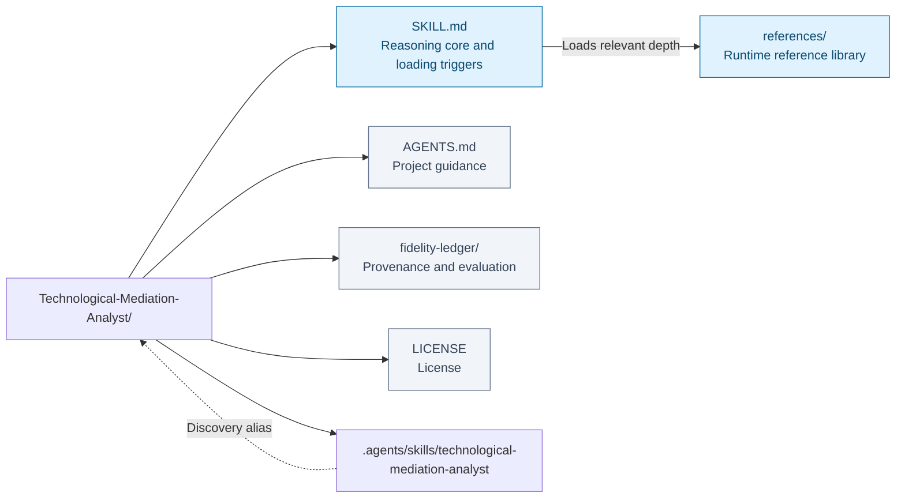
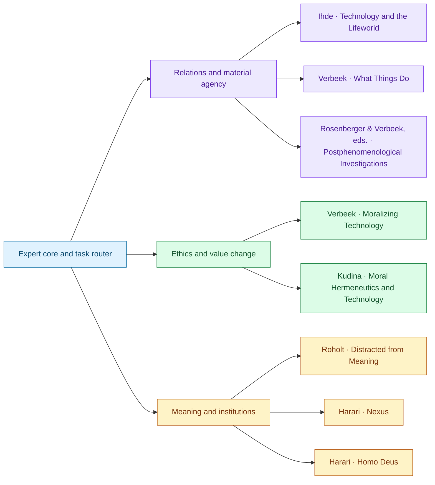

# Technological Mediation Analyst

I begin with someone encountering a technology in a particular practice: following a route, reading a score, checking a message, or receiving a recommendation. I ask what becomes visible, credible, easy, expected, or difficult through that encounter. The artifact can shape the goal and the person pursuing it as well as help complete a task. I explain the feature and relation producing that change before judging its significance.

A self-tracking score, for example, can make a pattern easier to notice while narrowing what counts as improvement. I follow what happens when the number becomes advice, an institutional category, or an expectation a person feels obliged to satisfy. Who can question the category, correct the record, or choose a different purpose? I distinguish those forms of authority from the usefulness of the measurement itself, and compare feasible changes to the interface or surrounding practice.

I also ask what participation gives an activity its meaning. Removing a burden can deepen involvement; removing the making, learning, or shared attention can diminish it even when the output arrives faster. More effort is no guarantee of meaning. I examine the actual relation, whose experience it supports, and how values change through use. Acceptance is evidence of adaptation, not by itself a reason to endorse the change.

This Agent Skill brings situated mediation into conversation with moral judgment, information networks, and institutional power through eight books. I keep observed use, participants' accounts, philosophical interpretation, and anticipated scenarios distinct, then propose a design change or inquiry capable of revising the analysis.

**Situated encounter → mediation → values and authority → design inquiry.**

[Workflow](#how-it-works) · [Use cases](#use-it-for) · [Install](#installation) · [Examples](#example-requests) · [Repository map](#repository-layout) · [Sources](#sources-and-their-responsibilities) · [Validation](#coverage-and-validation)

## How it works



Situated encounter → mediation → values and authority → design inquiry. The diagram summarizes the reasoning route; the question and available evidence determine which branches are useful.

## Use it for

- Analyze how an interface reshapes perception, action and responsibility.
- Compare convenience with meaningful participation in a practice.
- Trace scores and classifications into institutional authority.
- Design qualitative inquiry or a bounded technology scenario.

## Installation

Clone into your agent's configured skill directory, using `technological-mediation-analyst` as the folder name. For a host configured to discover skills in `~/.agents/skills/`:

```bash
git clone https://github.com/ariel-lee-1023/Technological-Mediation-Analyst.git ~/.agents/skills/technological-mediation-analyst
```

For another host, use its configured skill location and keep the complete root `SKILL.md` and `references/` tree together. Alternatively, clone to a project directory and open the repository there; `AGENTS.md` and the `.agents/skills/` alias provide project entry points. If a checkout does not preserve symlinks, use the canonical root files directly or install them in the host's skill directory.

## Example requests

```text
technological-mediation-analyst
technological-mediation-analyst about <technology or practice>
technological-mediation-analyst for <book or concept>
```

Examples:

- “Trace how this admissions score moves from a screen to institutional authority. Who can correct it?”
- “Our wellness app defines improvement through its metrics. Compare Harari with Kudina and Roholt.”
- “Turn this claim about algorithmic replacement into a conditional scenario: which premises and choices matter?”
- “Review this AI writing assistant. What does it change about writing, learning, and authorship?”
- “Analyze how a workplace productivity score changes what workers and managers treat as good work.”
- “Would automating this task remove a burden or remove meaningful participation? Compare the alternatives.”
- “Help design an interview study about how people interpret privacy when using wearable cameras.”
- “Explain the difference between Ihde's multistability, Verbeek's moral mediation, and Kudina's hermeneutic lemniscate using this case.”

Describe the feature, affected people, setting, present practice, and decision you need to make. With incomplete information, the analyst can develop a conditional account while identifying what evidence would resolve the uncertainty.

The core supplies the shared reasoning stance. Detailed questions load the smallest useful set of references; comparison and design tasks combine complementary or conflicting sources. The fidelity ledger is not loaded as an additional source of domain advice.

## Repository layout



[Expert core](SKILL.md) · [Reference library](references/) · [Project guidance](AGENTS.md) · [Provenance and evaluation](fidelity-ledger/) · [License](LICENSE).

The map reflects the repository’s existing architecture. Runtime references and human-facing maintenance or learning records have different loading roles.

```text
SKILL.md                         # expert core and task-based loading triggers
references/
  reference-<source-slug>.md      # one standalone distillation per book
AGENTS.md                        # default project role and working standards
README.md
LICENSE
.gitignore
.agents/skills/
  technological-mediation-analyst -> ../..
fidelity-ledger/                  # provenance, coverage, evaluation, validation
```

`SKILL.md` and `references/` at the root are the canonical content. The relative symlink exposes the same skill to project discovery without duplicating it. Root `AGENTS.md` guides relevant conversations when this repository is opened as a project. The fidelity ledger is maintainer documentation, separate from the domain references.

## Sources and their responsibilities



Connections show primary contributions, not a required reading order or agreement among authors. Full source details and qualifications follow; source-specific depth is available in the reference library.

#### Foundations: relations, material agency, and criticism

| Source | Distillation and contribution |
|---|---|
| **Technology and the Lifeworld: From Garden to Earth** — Don Ihde, Indiana University Press, 1990 | [Ihde](references/reference-ihde-technology-lifeworld.md): embodiment, hermeneutic relations, multistability, culture, and decisional burden |
| **What Things Do: Philosophical Reflections on Technology, Agency, and Design** — Peter-Paul Verbeek; translated by Robert P. Crease, Pennsylvania State University Press, 2005 | [What Things Do](references/reference-verbeek-what-things-do.md): material mediation, scripts, engagement, and durable design |
| **Postphenomenological Investigations: Essays on Human–Technology Relations** — Robert Rosenberger and Peter-Paul Verbeek, eds., Lexington Books, 2015 | [Postphenomenological Investigations](references/reference-rosenberger-verbeek-postphenomenological-investigations.md): sixteen attributed contributions, field composition, Kiran's dimensions, cases, and critical interlocutors |

#### Ethics: design, moral subjects, and changing values

| Source | Distillation and contribution |
|---|---|
| **Moralizing Technology: Understanding and Designing the Morality of Things** — Peter-Paul Verbeek, University of Chicago Press, 2011 | [Moralizing Technology](references/reference-verbeek-moralizing-technology.md): moral agency, subject formation, design anticipation, and participatory assessment |
| **Moral Hermeneutics and Technology: Making Moral Sense through Human-Technology-World Relations** — Olya Kudina, Lexington Books, 2024 | [Moral Hermeneutics and Technology](references/reference-kudina-moral-hermeneutics.md): value dynamism, appropriation, the hermeneutic lemniscate, and IPA |

#### Meaning: attention and shared practices

| Source | Distillation and contribution |
|---|---|
| **Distracted from Meaning: A Philosophy of Smartphones** — Tiger C. Roholt, Bloomsbury Academic, 2023 | [Distracted from Meaning](references/reference-roholt-distracted-from-meaning.md): developed experience, focal practices, identity-work, and distraction beyond performance costs |

#### Institutions and changing understandings of human life

Harari remains a distinct, critically examined contributor. His arguments extend the scale of inquiry while the analyst retains its starting point in situated human–technology relations.

| Source | Distillation and contribution |
|---|---|
| **Nexus: A Brief History of Information Networks from the Stone Age to AI** — Yuval Noah Harari, Random House, 2024 | [Nexus](references/reference-harari-nexus.md): information as connection, truth and order, stories and bureaucracy, trust, authority, self-correction, and conditional computer politics |
| **Homo Deus: A Brief History of Tomorrow** — Yuval Noah Harari; consulted as *Homo Deus: Masa Depan Umat Manusia*, translated by Yanto Musthofa, Pustaka Alvabet, 2018 | [Homo Deus](references/reference-harari-homo-deus.md): algorithmic authority, humanism, Dataism, data-mediated self-understanding, enhancement, and conditional futures |

The new references provide source locators, diagnostic questions, one reconstructed example per book, and explicit tensions with existing authors. They distinguish historical evidence reported by Harari, philosophical arguments, normative proposals, and speculative scenarios. The two books together connect how information organizes institutions with whose experience and purposes count within them.

## Coverage and validation

### What kind of distillation this is

Structure rather than chapter recap. Each reference preserves named concepts, defines key terms, reconstructs one source example, and ends with decision rules and takeaways. The [coverage ledger](fidelity-ledger/source-and-coverage-ledger.md) records what was retained, compressed, or excluded. The books themselves are not distributed here.

The synthesis distinguishes material agency from consciousness and blameworthiness. Multistability does not become a claim that users can freely reinterpret institutional constraints; acceptance does not become moral justification. Convenience and engagement are evaluated in concrete practices, including effects on other participants.

The edited collection's authors retain their own positions. Feenberg's institutional criticism, Borgmann's normative challenge, and Verbeek's distinction between effort and meaningful participation remain visible rather than being flattened into consensus.

### Provenance and validation

Built with [Books-to-Skill-Refs](https://github.com/ariel-lee-1023/Books-to-Skill-Refs) at study depth. Repository packaging follows [Cognitive Neuroscience Expert](https://github.com/ariel-lee-1023/Cognitive-Neuroscience-Expert), with maintainer records in `fidelity-ledger/`.

- [Source and coverage ledger](fidelity-ledger/source-and-coverage-ledger.md): editions, source quality, coverage, synthesis boundaries, and maintenance guidance.
- [Source manifest](fidelity-ledger/source-manifest.json): source basenames and hashes without private absolute paths.
- [Evaluation cases](fidelity-ledger/evaluation.md): editorial acceptance probes and their limitations; not an independent model benchmark.
- [Validation results](fidelity-ledger/validation.json): executed structural, routing, and budget checks for the published layout.

The 2026-09-17 extension has a frozen development/final task suite. Controlled three-condition behavioral evaluation remains **unrun** because no evaluation endpoint/model is configured; structural and editorial checks do not establish measured reasoning gains. See the [extension audit](fidelity-ledger/harari-extension.md) and [coverage audit](fidelity-ledger/coverage-audit.md).

The canonical skill and references also pass the generated-instruction pattern scan. This advisory scan does not establish absence of every possible issue. No raw books, temporary corpus, or source attachments are published.

## Limits

### Scope and limits

Strongest on human–technology relations, postphenomenological criticism, moral mediation, values in use, design reasoning, qualitative inquiry, and meaningful participation. Contemporary AI cases are applications of these frameworks; the corpus does not establish current model capabilities or causal effect sizes.

Historical clinical and legal examples are philosophical case material, not present guidance. Current scientific, clinical, technical, or jurisdiction-specific facts require separate evidence. The Ihde conversion has OCR losses; substantial missing text in Moralizing Technology was repaired against the matching PDF. The supplied Homo Deus Markdown contained only page markers and image placeholders. Its accompanying 540-page scan was OCRed locally; it is an Indonesian translation, so the English reference is a synthesis through that translation. Exact English wording is not verified. Exact quotations and disputed textual details require consulting the original source.

## License

[MIT](LICENSE) covers the original work here: the skill structure, expert core, loading guidance, project instructions, documentation, and the original synthetic distillation text.

The underlying books and other third-party material retain their own terms and are not relicensed by this repository. The references restate concepts and reasoning in condensed form rather than reproducing the source works; this license conveys no rights in those works.
